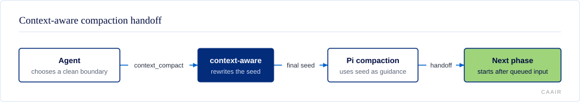
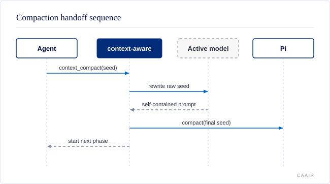

# @centerforagenticai/pi-context-aware

**Kind:** extension · **Status:** stable · **Pi:** * · **Node:** >=22.19.0

Context-aware helps long Pi sessions keep their purpose through compaction. It tracks context pressure, turns short handoff seeds into self-contained prompts, and carries selected reference material and the session focus into the next phase. Focus and the task list belong to pi-workstream; this package reads the focus for compaction, `/checkin`, `/sessions` and cmux.

## What it does

- Shows context pressure and usable output headroom without changing the prompt on every tool call.
- Rewrites `/compact-then` and `context_compact` seeds before Pi compacts the conversation.
- Can compact proactively when context usage or output headroom reaches a configured limit.
- Preserves a prior-transcript reference and exposes bounded prior-session search.
- Keeps the session focus and scoped context-cache documents across compaction.
- Repairs orphaned tool results before provider requests leave the process.
- Erases closed sessions through a user-only command with a durable erasure ledger.
- Offers a typed protocol-v1 service for other Pi extensions.

The detailed behavior, recovery rules, and examples are in [commands and concepts](docs/commands-and-concepts.md).

## How it fits





The agent starts a handoff with `context_compact` or `/compact-then`. Context-aware resolves or generates a raw seed, asks the active model to rewrite it when rewriting is enabled, then gives the final seed to Pi as compaction guidance. After Pi drains queued input, context-aware delivers the seed once to start the next phase. In a worker session, it records a round-boundary request instead of starting a new turn.

The extension also listens to Pi lifecycle events. It records stable task, focus, cache, and transcript metadata in the session without treating those records as user instructions.

## Install and enable

Install the public package with Pi:

```sh
pi install npm:@centerforagenticai/pi-context-aware
```

Restart Pi or run `/reload`. The package declares Pi peer dependencies as `*`; its deterministic compatibility gate tests the supported minimum, Pi `1.5.0`, and the development pin. Pi `1.0.x` to `1.3.x` are no longer supported; release 0.5.14 is the last release that declares Pi `1.0.3` as its minimum. It needs Node `>=22.19.0`.

For a local checkout, add its absolute path to the `packages` array in `~/.pi/agent/settings.json`, run `bun run build`, then restart Pi or run `/reload`. The manifest loads `./dist/extension.js`, which the build bundles into one file.

For seeded automatic handoffs, let context-aware own automatic compaction and turn off Pi's native automatic threshold checks:

```json
{
  "compaction": { "enabled": false }
}
```

Manual `/compact`, `/compact-then`, and `context_compact` remain available. See [configuration](docs/configuration.md) for ownership warnings and the complete settings.

When `billion-context-pi` is loaded, it cancels every compaction. Context-aware detects it at session start, stops offering `context_compact`, and turns proactive compaction off. It tells the agent to use billion-context-pi's own `compress` tool only when the current session can reach it; otherwise its model guidance falls back to keep-small/delegate and finish-atomic-work advice without naming that tool. See [compaction blocked by another extension](docs/commands-and-concepts.md#compaction-blocked-by-another-extension). `/fold-parity` reports read-only shadow comparisons of billion-context-pi's `compress` calls, including nested calls, and progress toward the 500-call cut-over gate; `/fold-parity all` lists every call that blocks it. See [fold parity](docs/fold-parity.md).

## Surface

One prompt section guides the context tools, within 1,500 tokens.

| Kind | Name | Purpose |
| --- | --- | --- |
| Tool | `context_compact` | Compact at a clean phase boundary and continue from a self-contained seed. Offered when `summarizer.enabled` is `true` and no loaded extension cancels every compaction. |
| Tool | `context_status` | Read context size and ladder stage, compaction boundaries and active folds. |
| Tool | `context_recall` | Recall text that left context: earlier sessions, this session, the context cache, or the entries behind a fold. |
| Tool | `context_fold` | Replace a consumed range of messages with a summary you write. Registered while billion-context-pi is not loaded. |
| Tool | `load_skill` | Load a skill by name; a repeat load of an unchanged skill returns a pointer to the earlier copy. |
| Command | `/compact-then [seed] [--model provider/id]` | Run the seeded handoff flow. Available when `summarizer.enabled` is `true`; refuses with the reason while another extension cancels every compaction. |
| Commands | `/context-status`, `/context-aware-*` | Inspect pressure and configure seed, model, ambiguity, and proactive behavior. |
| Commands | `/sessions`, `/checkin` | List sessions and their health, and run a read-only check-in of the focus that asks for pi-workstream's task list when its tool is active. |
| Commands | `/context-cache-*` | Inspect and manage scoped context-cache documents. |
| Command | `/session-erase <session-id> [--range <ref>..<ref> \| --match <literal>]` | Permanently erase a closed session, or only a range or matching text in it, with preview, per-fork confirmation and an erasure receipt. |
| Export | `@centerforagenticai/pi-context-aware/context-service` | Discover the typed protocol-v1 service over `pi.events`. |

Every command, parameter, and example is in [commands and concepts](docs/commands-and-concepts.md), and [configuration](docs/configuration.md). The service contract is in [context-service.md](docs/context-service.md).

## Configuration

Settings come from built-in defaults, `~/.pi/agent/context-aware.json`, trusted project `.pi/context-aware.json`, CLI flags, session policy, and host policy. Later layers win per key.

| Key | Default | Purpose |
| --- | --- | --- |
| `seedMode` | `"auto-gen"` | Generate a seed when `/compact-then` has none. The file accepts `"auto-gen"` and `"user-approve"`. `autonomous` is a preset, not a file value: set it with `--context-aware-mode` or `/context-aware-seed-mode`. See [configuration](docs/configuration.md). |
| `seedRewrite` | `true` | Rewrite raw seeds into self-contained prompts. |
| `seedAuthorityGuard` | `"warn"` | Check generated handoffs against session authority. |
| `ambiguityMode` | `"inherit"` | Ask, proceed cautiously, or proceed automatically when a seed is unclear. |
| `compactionModel` | `null` | Use the active model unless a summary model is named. |
| `overflowFallbackModel` | `null` | Keep overflow recovery on the primary model unless another model is named. |
| `summarizer.enabled` | `true` | Own the compaction summary hook and register handoff surfaces. |
| `compactionClaim.enabled` | `false` | Claim compaction from pi-fabric so this extension writes the summary. Off until `billion-context-pi` leaves the profile. |
| `compactionClaim.fabricFallback` | `true` | While the claim is held, use pi-fabric's deterministic summary when the model summary fails. |
| `proactiveCompaction.enabled` | `true` | Prepare a handoff before the context limit; threshold defaults to the pressure ladder's seeded-compaction step (`0.9`). |
| `entryPressure.maxEntriesSinceCompaction` | `30000` | Compact, and report URGENT, once this many entries sit on the branch since the last compaction, even at low token usage. |
| `contextMetrics.enabled` | `true` | Append one numbers-only record per model request to `<agent dir>/context-aware/metrics/v1/<session-id>.jsonl`. See [`contextMetrics`](docs/configuration.md#contextmetrics). |
| `imageStripping.enabled` | `false` | Send only the newest `imageStripping.keepRecent` (default `5`) image-bearing messages with their images; older images become text placeholders. |
| `contextCache.enabled` | `true` | Surface scoped cache documents; the default scope is `"worktree"`. |
| `restartNotice.enabled` | `true` | Remind the agent to re-check volatile state after time away. |
| `operatorRequests.enabled` | `true` | Track each message you type until the agent answers it: remind the agent, ask for one more turn when a run leaves it unanswered, and show the last reply below the editor. `/requests` lists every request and its answer. See [`operatorRequests`](docs/configuration.md#operatorrequests). |
| `operatorRequests.sources` | `["interactive"]` | Which input opens a request: typed input only, or add `"rpc"` for an RPC client that a person drives. |
| `pressureTelemetry.mode` | `"full"` | What the pressure action line shows at WARN and URGENT: `"full"` (band, percent, headroom and action), `"band"` (band and action) or `"off"` (no line). Nothing is injected at OK. |
| `workstream.enabled` | `true` | Read the session focus into compaction, the registry, cmux and activity. |
| `sessionNaming.scope` | `"all"` | Name sessions with a bounded lightweight-model chain. |

Read [configuration](docs/configuration.md) for the full JSON shape, every leaf, precedence details, runtime flags, defaults, and recovery behavior.

The native fold engine also protects image-heavy requests without a setting. When the stored projection has more than 20 image parts, or its all-images estimate reaches the fold nudge ceiling, only the newest five image parts stay in the outgoing request. Older images become entry-addressed text placeholders, including older images in a partially elided boundary entry. The session file and original image bytes do not change. This automatic pass is inactive while `billion-context-pi` owns folding; the separate opt-in `imageStripping` hook keeps its existing behavior.

## When it runs

The extension starts session-scoped services on `session_start` and tears them down on `session_shutdown`. It adds stable context guidance before agent work, appends one pressure snapshot per outer user turn, and updates pressure after messages, model changes, and turns.

At `turn_end` and `agent_settled`, it may prepare proactive compaction, name the session, or record durable activity. At `session_before_compact`, it can produce the summary, cache artifacts, and handoff metadata. At `session_compact`, it records the completed boundary and schedules the next-phase seed. Features stay idle when disabled, when no relevant state exists, or when a worker host owns the round boundary.

## Develop

The source is maintained in a private repository and published as release snapshots; contributions are welcome as pull requests on [GitHub](https://github.com/CenterForAgenticAI/tools), which maintainers carry into the source repository.

```sh
bun install
npm test
```
## Documentation

- [docs/overview.md](docs/overview.md): the previous README's detailed product overview and installation reference, preserved verbatim.
- `docs/roadmap.md` (kept in the private source repository; not included in public releases): proposed context-management direction, milestones, evidence, and open decisions.
- [docs/commands-and-concepts.md](docs/commands-and-concepts.md): workflows, commands, compaction concepts, model routing, and recovery.
- [docs/folding.md](docs/folding.md): how context folding works, from the `context_fold` call to the provider request.
- [docs/configuration.md](docs/configuration.md): complete configuration reference, defaults, precedence, and runtime overrides.
- [docs/skills.md](docs/skills.md): `load_skill` resolution, the skill registry, and the pointer contract.
- [docs/integration.md](docs/integration.md): cross-extension protocol overview.
- [docs/development.md](docs/development.md): public install and test commands.
- [docs/diagrams/](docs/diagrams/): generated architecture diagram and its JSON source.
- [docs/context-service.md](docs/context-service.md): typed protocol-v1 discovery, operations, events, and bounds.

## License

MIT. See [LICENSE](LICENSE).

The fold engine in `src/folds/kernel` is a copy of [acp-kernel](https://github.com/ranxianglei/acp-kernel), used under its MIT license with an attribution term. The package ships its license and source commit in `dist/folds/kernel/PROVENANCE.md`.
