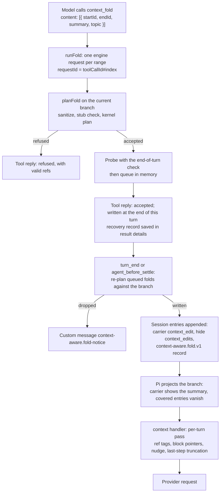

# How context folding works

A fold replaces an older range of the conversation with a summary the model wrote. The original entries stay in the session file and come back with `context_recall`. This page follows one fold from the tool call to the next provider request, then covers tiers, timing and measurement.

Each mechanism cites its source as `path:line`. Pi's own code is cited as it ships in `@earendil-works/pi-coding-agent` 1.5.2, under `node_modules/@earendil-works/pi-coding-agent/`.

## Terms

- **Session entry**: one line of Pi's session file, with a stable id. Messages, custom messages, custom records and context edits are all entries.
- **Context edit**: a `context_edit` entry. It replaces the content of one earlier entry in what the model is sent, or removes it (`replacement: null`). The edited entry itself is not changed (`node_modules/@earendil-works/pi-coding-agent/dist/core/session-manager.js:236`).
- **Ref**: a message ref such as `m00042`. The model reads it from the `<acp tokens="…" type="…">m00042</acp>` tag at the end of each message (`src/folds/kernel/render-refs.ts:45`).
- **Block id**: a fold's id, `b1`, `b2`, and so on. A block is the kernel's word for a fold.
- **Carrier**: the first entry a fold covers. Its content is replaced with the summary.
- **Kernel**: the fold engine copied verbatim from acp-kernel into `src/folds/kernel/`.
- **Adapter**: the code in `src/folds/` that runs the kernel on a Pi session.

## The flow at a glance

## 1. The life of one fold

### The call

The model calls `context_fold` with an array of ranges. Each range has `startId`, `endId`, `summary` and an optional `topic` (`src/context-tools/context-fold.ts:35`). The array goes in `content`, or in its alias `ranges`, and may arrive as a JSON string (`src/context-tools/context-fold.ts:46`, `src/context-tools/context-fold.ts:57`). `startRef`/`endRef` and `from`/`to` are accepted spellings of the bounds. A top-level `topic` is the fallback for ranges without one, and `summaryMaxChars` overrides the summary limit of 20,000 characters (`src/context-tools/context-fold.ts:58`, `src/context-tools/context-fold.ts:61`). One call may name at most 1,000 ranges (`src/folds/fold-entries.ts:76`).

The arguments are read through the kernel's own parser, so drift such as a stringified array is repaired or refused with a message naming the expected shape (`src/context-tools/context-fold.ts:186`). The tool is registered only while billion-context-pi is not loaded (`src/context-tools/context-fold.ts:19`).

Each range becomes one engine request with the id `<tool call id>#<item index>` (`src/context-tools/context-fold.ts:242`). The id makes the request idempotent: a durable worker that runs the same call again gets the first answer, not a second fold (`src/folds/fold-engine.ts:26`, `src/folds/fold-engine.ts:421`).

### How refs map to session entries

The adapter turns each entry the model is sent into kernel messages (`src/folds/fold-adapter.ts:104`):

- a user message, a custom message, or another non-assistant message becomes one `user` message;
- a tool result becomes one `tool` message;
- an assistant entry with one tool call becomes one message keyed by the entry id; an entry with several calls becomes one message per call, with the id `<entry id>#<call id>`;
- an assistant entry with no text and no call has no message.

Refs are then numbered in branch order over the entries Pi still sends after the last compaction (`src/folds/fold-adapter.ts:190`, `src/folds/fold-adapter.ts:198`). A compaction therefore restarts the numbering. Block ids come from the fold records on the branch (`src/folds/fold-adapter.ts:201`). The refs a model may name are the unfolded messages and the active blocks (`src/folds/fold-adapter.ts:243`).

A range is widened to whole entries and whole tool-call/result pairs before the kernel sees it (`src/folds/fold-adapter.ts:383`, `src/folds/fold-coverage.ts:8`). A range of blocks that would need widening is refused instead: `Block range would split an entry or tool pair` (`src/folds/fold-adapter.ts:389`).

### Validation and refusal

`planFold` checks a range in this order (`src/folds/fold-adapter.ts:365`):

1. **Summary repair.** A summary with more than 20 `\uXXXX` escapes is decoded once; fewer are left alone (`src/folds/fold-adapter.ts:369`, `src/folds/summary-sanitize.ts:13`, `src/folds/summary-sanitize.ts:61`).
2. **Cut-off summary.** A summary of 200 characters or fewer that ends in `…`, or a copied block pointer, is refused with a `[stub-summary]` error (`src/folds/fold-adapter.ts:370`, `src/folds/stub-summary.ts:33`). Models copy the shortened summaries they see in earlier calls; this stops a range becoming one cut-off line.
3. **Turn preparation.** The kernel prepares the turn as billion-context-pi does: folded messages replaced by their summaries, calls without a result removed (`src/folds/fold-adapter.ts:376`).
4. **Kernel validation.** The kernel plans the range (`src/folds/fold-adapter.ts:406`). Its refusals include:
   - **Protected zone.** The last 5 messages, the last 5,000 tokens, and the most recent user message are protected (`src/folds/kernel/config.ts:32`, `src/folds/kernel/recommend.ts:103`, `src/folds/kernel/recommend.ts:132`). A range entirely inside the zone is refused (`src/folds/kernel/compress.ts:1300`); a range that only touches it loses those messages with a warning (`src/folds/kernel/compress.ts:1308`). Only a message a person typed counts as the user's: an extension's custom message does not move the zone (`src/folds/fold-adapter.ts:575`).
   - **Split tool pairs.** A range that would separate a visible tool call from its reasoning or results at the zone boundary is refused or trimmed (`src/folds/kernel/compress.ts:1355`). The adapter then withdraws any Pi entry the trim would cut in half (`src/folds/fold-adapter.ts:345`, `src/folds/fold-adapter.ts:473`).
   - **Already compressed.** A message range whose messages all belong to active blocks is refused: `contains no new compressible messages` (`src/folds/kernel/compress.ts:1402`), or, when every range was consumed, `Requested range(s) already compressed` (`src/folds/kernel/compress.ts:559`).
   - **Too small.** The ranges must hold at least 5,000 characters (`src/folds/kernel/config.ts:26`, `src/folds/kernel/compress.ts:561`).
   - **Summary length.** Empty, under 50 characters, or over the limit (`src/folds/kernel/compress.ts:1516`).
   - **Refold blocked.** See [Refolding](#refolding).
5. **Kept opening message.** With `folds.firstUserMessage` at its default `keep`, the session's first user message stays visible; a range that would fold nothing else is refused (`src/folds/fold-adapter.ts:319`, `src/folds/fold-adapter.ts:432`).
6. **Nothing left.** If fold hints, skill swaps, the kept opening message, or withdrawn entries leave no entry to cover, the range is refused with that reason (`src/folds/fold-adapter.ts:489`).

A refused range is reported in the tool reply with the valid refs (`src/context-tools/context-fold.ts:244`). A call in which nothing was accepted is an error result (`src/context-tools/context-fold.ts:259`).

### Acceptance, the queue and the end of the turn

Pi accepts new session entries only at `turn_end` and `agent_before_settle`, so an accepted fold waits in an in-memory queue (`src/folds/fold-engine.ts:4`). Before it is queued, the engine runs the same check the end of the turn will run, so a range that the protected zone trims below 5,000 characters is refused at once (`src/folds/fold-engine.ts:554`). The request is bound to the branch leaf it was made on (`src/folds/fold-engine.ts:547`). The reply says `accepted; written at the end of this turn` (`src/context-tools/context-fold.ts:254`), and the tool result's `details` holds a recovery record for each accepted range (`src/context-tools/context-fold.ts:259`, `src/folds/fold-recovery.ts:417`).

At the boundary, the queued folds are planned again, in order, against an in-memory copy of the branch, so each fold sees the ones before it (`src/folds/fold-engine.ts:344`, `src/folds/fold-engine.ts:632`). A fold is written only to the branch it was accepted on and over exactly the entries and content it was accepted over (`src/folds/fold-engine.ts:20`, `src/folds/fold-recovery.ts:706`). Otherwise it is dropped with a code: `entry-missing`, `coverage-changed`, `source-changed`, `branch-changed`, `refused`, `plan-failed` or `too-large` (`src/folds/fold-recovery.ts:54`).

### What is appended to the session

For each written fold, in this order (`src/folds/fold-entries.ts:148`):

1. one `context_edit` that replaces the carrier's content with the summary text;
2. one `context_edit` with `replacement: null` for every other covered entry, so Pi leaves it out of the request;
3. one `custom` entry of type `context-aware.fold.v1` holding the fold record: `blockId`, `runId`, `tier`, `topic`, `carrierId`, `hiddenIds`, `range`, the `refs` the request named, `directBlockIds` (absorbed folds), `compressedTokens`, `createdAt`, `origin` and `requestId` (`src/folds/fold-entries.ts:26`, `src/folds/fold-entries.ts:34`).

A fold that also swaps condensed content adds one more `context_edit` per swapped entry (`src/folds/fold-adapter.ts:527`, `src/folds/fold-adapter.ts:591`).

If any accepted fold was dropped, the boundary also appends one custom message of type `context-aware.fold-notice`. It names up to three dropped folds with their reasons and counts the rest (`src/folds/fold-engine.ts:770`, `src/folds/fold-engine.ts:731`). Pi sends it to the model with the next request.

## 2. What is left behind in the model's context

The model writes the summary. Nothing in the extension generates or rewrites summary text: `summary-sanitize.ts` only decodes double-escaped Unicode, and `stub-summary.ts` only refuses a cut-off or copied summary. After a fold, the model's context holds these pieces.

| Piece | What the model sees | Generated by |
| --- | --- | --- |
| Summary | The carrier's content becomes `[Compressed conversation section] — <topic>`, a newline, then the trimmed summary. Without a topic the heading has no dash (`src/folds/fold-entries.ts:132`, `src/folds/kernel/prune.ts:4`). | The model's `summary` and `topic` arguments, rendered by the adapter (`src/folds/fold-adapter.ts:524`). |
| One-line hint records | Under the summary, one line per covered entry that has a `one-line` fold hint (`src/folds/fold-adapter.ts:519`). | The hint's `line` or its `summarize` function (`src/folds/fold-hints.ts:26`). |
| Carrier message | The carrier keeps its own role. Pi replaces its content; an assistant or tool-result carrier's text becomes one text part (`node_modules/@earendil-works/pi-coding-agent/dist/core/session-manager.js:243`). The per-turn pass sends the carrier as Pi built it, with no ref tag (`src/folds/fold-turn.ts:703`). | Pi's projection of the carrier `context_edit`. |
| Hidden entries | Nothing. Every other covered entry is left out (`node_modules/@earendil-works/pi-coding-agent/dist/core/session-manager.js:241`). | The null `context_edit` entries. |
| The fold call | The model's own `context_fold` call stays in context, but each written item's `summary` argument is shown as a pointer such as `summary kept in block b6 (9,585 chars)` (`src/folds/fold-call-render.ts:32`). A call whose fold was later absorbed is left out, as are failed fold calls beyond the newest two (`src/folds/fold-turn.ts:11`). The session file keeps the call as written. | `renderEarlierFoldCalls` in the `context` handler (`src/folds/fold-engine.ts:405`). |
| Block ids | The model learns `bN` from the call pointer, from the nudge's `Blocks: …` line (`src/folds/fold-turn.ts:958`), and from `context_status({ view: "folds" })`. The summary heading does not name the block. | The fold record's `blockId`. |
| Ref tags | Every user, custom and tool-result message still visible keeps its `<acp>` tag with its ref and token count (`src/folds/fold-turn.ts:9`). | The kernel's ref renderer. |
| Kept entries | Entries the fold covers but does not hide (below). | The rules below. |

What stays verbatim inside a folded range:

- **`verbatim` hints.** An entry whose fold hint is `verbatim` is kept out of the fold, unless it or its paired call or result is over 16,000 characters (`src/folds/fold-adapter.ts:458`, `src/folds/fold-hints.ts:83`, `src/folds/fold-adapter.ts:549`). Context-aware registers `verbatim` for the `ask` tool (`src/folds/fold-hints.ts:240`).
- **`condensed` hints and condensed skills.** The entry stays visible but shows its condensed text, through a separate `context_edit` (`src/folds/fold-adapter.ts:460`). With `folds.condensedSkills` on, a skill block with a captured `condensed.md` is swapped the same way (`src/folds/fold-adapter.ts:465`, `src/index.ts:9058`).
- **Protected tools.** A recorded `load_skill` result is a protected tool message and stays out of the fold (`src/index.ts:9057`, `src/folds/kernel/protected.ts:113`).
- **The protected zone and the opening user message**, as described under validation.

`drop-after-read` hints matter at compaction, not at fold time. A covered entry with this hint is hidden like any other. At compaction, such a message is removed once an assistant message follows it (`src/folds/fold-hints.ts:440`). Context-aware registers it for its own fold notice (`src/folds/fold-hints.ts:241`).

## 3. Where the originals go and how they come back

The originals do not move. A fold only appends entries; the covered entries stay on the branch (`src/folds/fold-entries.ts:12`).

`context_recall({ ref: "b5" })` reads the covered entries back from the branch, carrier first, and returns up to 12,000 characters per call, with an `offset` for the next page (`src/context-tools/context-recall-ref.ts:16`, `src/context-tools/context-recall-ref.ts:113`). It writes nothing; the fold stays in place. The same tool reads a recoverable hide such as `h1`. When billion-context-pi is loaded, the folds belong to it and the ref is refused (`src/context-tools/context-recall-ref.ts:57`).

**Branches.** Pi applies context edits along the selected branch only, so a fold follows the branch it was made on through restart, `/tree` and fork (`src/folds/fold-entries.ts:12`). Navigating the tree discards the in-memory queue and rebuilds it from the records on the new branch (`src/folds/fold-engine.ts:310`). A request accepted on one branch is never written to another (`src/folds/fold-recovery.ts:48`). `src/folds/branch-cache.ts` is a speed-up, not a branch rule: it appends many fold drafts in linear time when importing legacy billion-context-pi folds (`src/folds/branch-cache.ts:29`, `src/folds/acp-startup-import.ts:82`).

**Recovery after a restart.** If the process dies after the tool reply but before the boundary, the recovery records saved in the tool result bring the request back. At `session_start` the engine scans tool results after the last compaction and queues every accepted request that was not written (`src/folds/fold-engine.ts:281`, `src/folds/fold-recovery.ts:496`). The record stores entry ids and a digest of the source, never refs (`src/folds/fold-recovery.ts:13`). A recovered fold is written only if the same check passes.

**Erasure.** `/session-erase` on a whole session deletes the transcript, and the folds with it. `--range` and `--match` also erase the copies a fold holds: the carrier `context_edit` text and the fold record's `topic`. Ids and links stay (`src/erasure/coverage.ts:4`, `src/erasure/tombstone.ts:112`, `src/erasure/tombstone.ts:115`). See [`/session-erase`](commands-and-concepts.md#session-erase-session-id).

## 4. Tiers and hierarchy

A fold of message refs is **tier 1**. A fold whose range is given by block ids absorbs the active blocks of the lowest tier it spans and is one tier higher, up to tier 3 (`src/folds/kernel/compress.ts:1219`, `src/folds/kernel/compress.ts:1590`). The absorbed blocks' ids go in the new record's `directBlockIds`, and the new summary replaces theirs (`src/folds/kernel/compress.ts:1228`). A block that a later fold absorbed is no longer active (`src/folds/fold-adapter.ts:188`). `context_recall` on the new block returns the original entries of everything it covers.

The native per-turn pass suggests distilling tier 1 into tier 2 at 10 active tier-1 blocks, and tier 2 into tier 3 at 20 tier-2 blocks (`src/folds/fold-turn.ts:82`). The kernel's own defaults are 1,000 and 2,000 (`src/folds/kernel/config.ts:8`); [fold parity](fold-parity.md) records the difference as FP-201.

### Refolding

A new summary for a range that active blocks already cover is a refold. The kernel allows it only for a block whose originals were restored inline in the context, and then updates the block in place (`src/folds/kernel/compress.ts:1379`, `src/folds/kernel/compress.ts:313`). Otherwise it refuses with `Refold blocked: … blocked by bN (not restored)` (`src/folds/kernel/compress.ts:286`, `src/folds/kernel/compress.ts:532`). The adapter never marks a block restored inline (`src/folds/fold-adapter.ts:201`), and `context_recall` does not restore inline, so in this extension a covered range is rewritten only by folding its blocks into a higher tier.

### Kernel versus adapter

The kernel is acp-kernel 0.0.101, copied file for file and never edited here (`src/folds/kernel/PROVENANCE.md`, `src/folds/PROVENANCE.md`).

The **kernel** decides:

- ref numbering and the `<acp>` tags;
- the protected zone, tool-pair integrity, size and summary-length limits, and the refusal wording;
- tiers, absorption and refolds;
- turn preparation, the nudge decision and text, and emergency truncation.

The **adapter** decides:

- how Pi entries become kernel messages and how blocks are rebuilt from the session (`src/folds/fold-adapter.ts:104`, `src/folds/fold-adapter.ts:182`);
- the summary repair and the cut-off summary refusal;
- widening to whole entries, the carrier, the stored entries and the session format;
- the typed-user protected zone, the kept opening message, fold hints and condensed skills;
- the queue, the boundary write, replay, recovery, notices and branch binding (`src/folds/fold-engine.ts`, `src/folds/fold-recovery.ts`);
- the ladder thresholds the kernel runs with, and the block pointers in earlier fold calls.

## 5. When folding happens

The model decides when to fold. The extension only prompts it, and only compaction or the last ladder step acts without the model.

All thresholds are shares of the full context window. The defaults come from the pressure ladder (`src/context-service.ts:556`; see [`pressureLadder`](configuration.md#pressureladder)):

| Usage | Band | What happens |
| --- | --- | --- |
| under 45% | `OK` | Nothing. |
| 45% to 75% | `WARN` | The per-turn pass may append a fold nudge. |
| 75% to 90% | `WARN` | The nudge becomes the forced over-limit nudge. |
| 90% | `URGENT` | Proactive compaction triggers, if enabled. |
| 95% | `URGENT` | Emergency nudge, emergency truncation, then a recoverable hide. |

The ladder becomes the kernel's `nudge.minContextLimitPct`, `nudge.maxContextLimitPct`, `nudge.emergencyThresholdPct` and `truncate.threshold` (`src/folds/fold-turn.ts:479`).

**The per-turn pass.** Before every provider request, the `context` handler runs `prepareFoldTurn` on the outgoing messages (`src/folds/fold-engine.ts:366`, `src/folds/fold-turn.ts:277`). It adds ref tags, hides absorbed fold calls, keeps only the newest five images when a request has too many, and appends the kernel's nudge when it recommends one (`src/folds/fold-turn.ts:9`). The nudge is a user-role message inserted into that request only; it is never stored in the session (`src/folds/fold-turn.ts:402`). Its text is the kernel's, with the tool named `context_fold`, plus a line listing the active blocks (`src/folds/fold-turn.ts:947`). It is shown at most once per user turn.

**The last step.** At 95% the kernel shortens large old messages in the request to their first and last 2,000 characters. At the next boundary the engine stores each as a recoverable hide (`context-aware.hide.v1`, ids `h1`, `h2`, …) with a `[Recover the original with context_recall({ ref: "h1" }).]` line (`src/folds/fold-engine.ts:391`, `src/folds/hide-entries.ts:8`, `src/folds/hide-entries.ts:87`). A hide is not a fold; see [What the last step does](configuration.md#what-the-last-step-does).

**The pressure action line.** At `WARN` and `URGENT` one action line joins the request; when the nudge is due on the same request, the line is appended to it, so the model gets one injected message. Neither is persisted. See [Cache-aware context pressure](commands-and-concepts.md#cache-aware-context-pressure).

**Compaction.** Folding and compaction are separate. A fold keeps the originals on the branch and the model's view of them is one summary; compaction cuts the context at a boundary and starts the next phase from a seed. `context_compact` and `/compact-then` compact on request (`src/index.ts:10125`, `src/index.ts:10291`). Proactive compaction triggers after a completed turn at `proactiveCompaction.thresholdFraction`, which follows the ladder's 90% unless set (`src/platform/config-layers.ts:276`). When context-aware writes the compaction summary, it adds an index of the active folds with their ids, so the next phase can still recall them (`src/index.ts:9997`, `src/compaction/owner-folds.ts:43`), and applies fold hints to what the summary reads (`src/index.ts:9991`). After a compaction, refs restart and recovery scans only the tool results after it (`src/folds/fold-recovery.ts:504`).

**Which engine runs.** With `folds.engine` at its default `auto`, native folds run unless billion-context-pi is loaded. While it is loaded, the engine is in shadow mode: it plans folds for comparison and writes nothing (`src/folds/fold-engine.ts:10`, `src/folds/fold-engine.ts:118`).

## 6. What is measured

- **Metrics v1.** One JSON line per model request in `<agent dir>/context-aware/metrics/v1/<session-id>.jsonl` (`src/metrics/records.ts:14`). Each record holds the pressure and band, the nudge kind, truncation and hide counts, folds requested, accepted, refused and dropped by reason code, and any compaction. `folds.tiers` is `null` today because the engine does not report tiers (`src/metrics/recorder.ts:154`). See [`contextMetrics`](configuration.md#contextmetrics).
- **`context_status({ view: "folds" })`.** The engine and mode, pending requests, the folds dropped in the last batch with reasons, and up to 40 active folds with tier, topic and refs (`src/context-tools/context-status.ts:115`).
- **Fold parity.** While billion-context-pi is loaded, `/fold-parity` compares its folds with what the native engine would do. See [fold parity](fold-parity.md).
